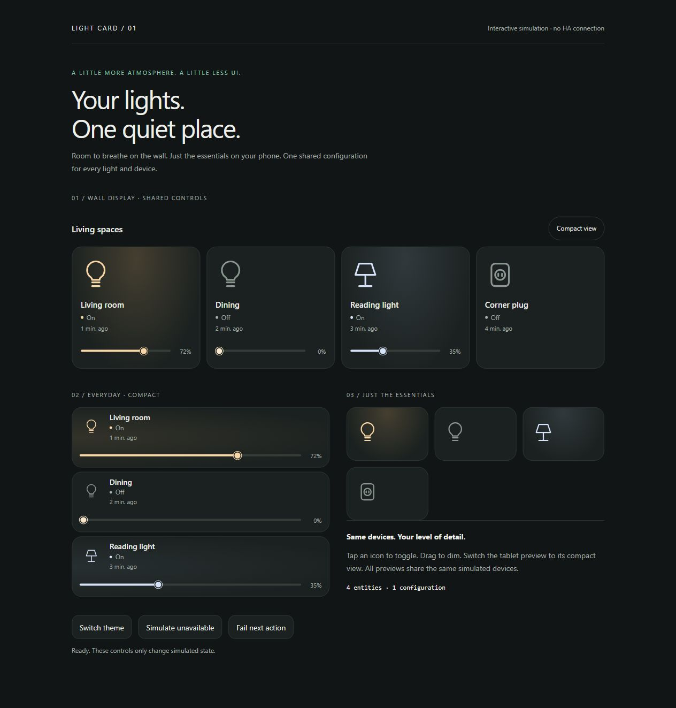

# Light Card

One shared configuration for your lights and devices. Spacious tiles on a wall display, slim rows in your everyday dashboard.



[Light theme preview](docs/images/preview-light.jpg). Screenshots use simulated entities.

[](https://github.com/jancrab/homeassistant-light-card/actions)
[](https://my.home-assistant.io/redirect/hacs_repository/?owner=jancrab&repository=homeassistant-light-card&category=plugin)

## Features

- One or many entities with shared appearance and actions; four columns by default, wrapping to fit the card's container.
- Tablet, compact and automatic layouts. Optional dashboard button switches views for the current card session.
- Large state-colored entity icons, optional light glow and actual RGB light colors. Color temperature uses an approximate warm/neutral/cool tint.
- Thin brightness track with a 44 px touch area, keyboard support and percentage. Only shown for lights advertising dimming support.
- Optional name, state, last state change, details button and controls only while on. Relative times follow your HA language and refresh every 30 seconds while the page is visible.
- Compact-specific appearance overrides, optional per-entity names/icons, and a collapsible visual editor with native HA selectors.
- Light/switch/helper/fan/automation toggling; buttons press and scenes/scripts activate. Explicit missing/unavailable states, pending feedback and retryable errors.
- HA theme colors, no external fonts/CDNs, reduced-motion support and Sections sizing.

## Install with HACS

1. In HACS, open **Custom repositories** and add `https://github.com/jancrab/homeassistant-light-card` with type **Dashboard**.
2. Download **Light Card**, then reload your browser.
3. Confirm this JavaScript module resource exists: `/hacsfiles/homeassistant-light-card/homeassistant-light-card.js`.
4. Edit your dashboard, add **Light Card**, and select your entities in the visual editor.

This is a HACS **custom repository**, not an entry in the default HACS catalog. No backend integration is installed. Use a current Home Assistant frontend and modern browser/WebView with CSS container-query and color-mix support.

## Manual installation

Download `homeassistant-light-card.js` from the [latest release](https://github.com/jancrab/homeassistant-light-card/releases/latest) and copy it to `/config/www/`. Add `/local/homeassistant-light-card.js?v=1.0.0` as a JavaScript module under **Settings → Dashboards → Resources** (advanced mode may be needed). Reload the browser. On updates replace the file and change the version query on the existing resource; do not add a duplicate.

## Quick start

```yaml
type: custom:homeassistant-light-card
title: Living spaces
entities:
  - light.living_room
  - light.dining
  - light.reading
  - switch.corner
columns: 4
layout: tablet
show_layout_toggle: true
appearance:
  show_last_changed: true
  show_brightness: true
compact:
  show_last_changed: false
  show_brightness: false
```

All options above are available in the visual editor. Pick **Automatic** to use compact rows below **600 px card width** and tablet tiles above it. The dashboard toggle temporarily overrides that choice; reloading restores the configured default. To use the same design on two dashboards, copy the card configuration and choose `tablet` or `compact` as each default. Separate card instances do not synchronize their saved configuration.

For a single device, `entity: light.living_room` is also supported. Use entities, not device registry IDs. Supported domains: `light`, `switch`, `input_boolean`, `fan`, `automation`, `button`, `input_button`, `scene`, `script`.

## Configuration

| Option | Default | Description |
| --- | --- | --- |
| `entities` | required | Entity IDs or objects with `entity`, optional `name` and `icon`. |
| `title` | none | Optional heading. |
| `layout` | `tablet` | `tablet`, `compact`, `auto`. |
| `columns` | `4` | Maximum tablet columns (1–12). Tiles wrap below 132 px each. |
| `compact_columns` | `1` | Maximum compact columns (1–12). Rows wrap below 220 px each. |
| `show_layout_toggle` | `false` | Show the tablet/compact switch on the dashboard. |
| `tap_action` | `toggle` | `toggle`, `more-info`, `none`. Toggle activates momentary entities. |
| `appearance` | see below | Shared display settings. |
| `compact` | inherited | Override selected display settings for compact view; default icon size is 28 px. |

| Appearance option | Default | Description |
| --- | --- | --- |
| `show_icon` | `true` | Show the entity icon. |
| `icon_size` | `56` | 24–96 px in tablet view. |
| `show_name` | `true` | Show friendly name or custom name. |
| `show_state` | `true` | Show the current state. Errors/unavailability remain visible. |
| `show_last_changed` | `false` | Relative time from HA's `last_changed`, not `last_updated`. |
| `show_brightness` | `true` | Slider only for dimmable lights. |
| `show_brightness_value` | `true` | Percentage beside the slider. Missing measurements display a dash. |
| `controls_when_on` | `false` | Hide sliders when off. May change card height. |
| `use_light_color` | `true` | Use the reported RGB color or approximate Kelvin tint. |
| `show_glow` | `true` | Subtle state-driven background. |
| `show_more_info` | `false` | Separate details button. |

Individual overrides keep the shared layout:

```yaml
entities:
  - entity: light.reading
    name: Reading corner
    icon: mdi:floor-lamp
  - switch.corner
```

The slider sends one service call when a drag is committed. Keyboard changes are serialized, keeping the newest pending value. Zero calls `light.turn_off`; positive values use `light.turn_on` with `brightness_pct`. State remains based on HA feedback. `last_changed` measures state transitions: changing brightness without changing on/off generally does not reset it. RGB/color-temperature controls are accessible via the optional native details button.

## Preview and development

```sh
npm ci
npm run check
npm run dev
```

Open `http://127.0.0.1:4173` for an interactive **simulation** using the actual built card. The preview's icon stand-in is only for the demo; production uses `ha-icon`. Switch themes, toggle/dim devices and simulate an unavailable device or failed service call.

The test suite covers configuration, service targeting, capability checks, serialized slider commands, failures, view overrides, reused `hass` objects, states-context cleanup and editor bootstrap/preservation. Browser checks cover responsive layout and interactions. **No real Home Assistant instance or physical device was used for v1.0.0 validation.** In particular the native selector/editor integration still needs an installation smoke test in HA.

Commit `package-lock.json` and `dist/homeassistant-light-card.js`. CI rebuilds and checks that the committed bundle matches. A matching `v` version tag runs the release workflow and publishes the bundled JavaScript asset.

See [feature research](docs/feature-research.md), [working guide](docs/working-guide.md) and [AGENTS.md](AGENTS.md). MIT; see [LICENSE](LICENSE). No upstream card code or assets were copied.
